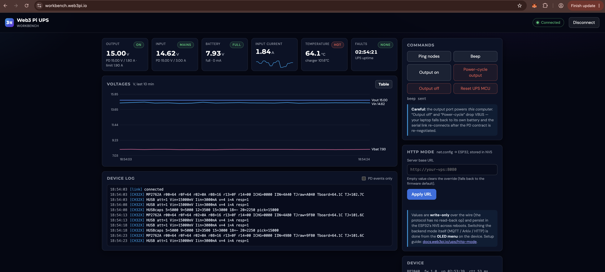
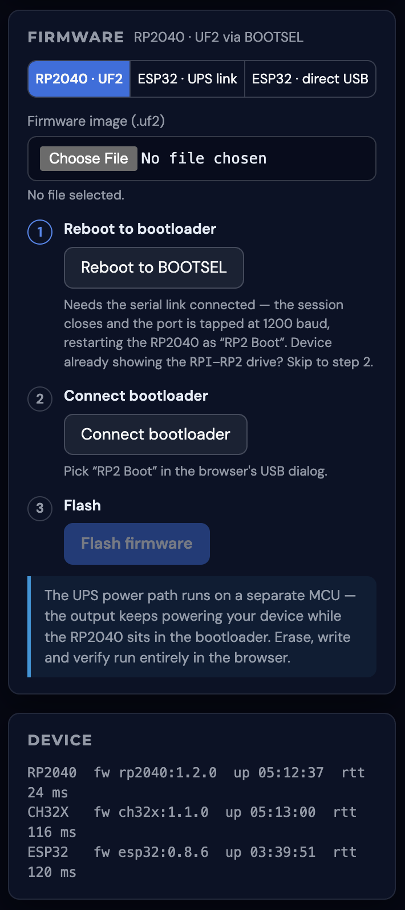

# Web3 Pi UPS Workbench

Live telemetry, device commands, HTTP-mode configuration and firmware tools for the
[Web3 Pi UPS](https://github.com/Web3-Pi/Web3-Pi-UPS) — straight from the
browser, over the [Web Serial API](https://developer.mozilla.org/en-US/docs/Web/API/Web_Serial_API).
The app is a static HTML/CSS/JavaScript site; device communication runs locally in the browser with no application backend or build step.



Plug the UPS **output** USB-C port into your laptop: the UPS keeps powering
the laptop (USB-PD) while handing it the USB host role (PD DR_Swap), so the
RP2040's WUPS serial stream is available directly. This page speaks the
[WUPS binary protocol v1](https://github.com/Web3-Pi/Web3-Pi-UPS/blob/main/common/protocol.h)
client-side and shows:

- **Live dashboard** — output/input rails with PD contracts, battery and
  charge state, temperatures, faults, plus a voltages timeline (with table
  view) and current sparkline
- **Device log** — `system.log` frames from all MCUs, including the CH32X
  `PD: ...` protocol event trace, and `power.event` broadcasts
- **Commands** — ping all nodes (firmware versions + RTT), beep, output
  on/off/power-cycle, UPS MCU reset
- **HTTP mode config** — sets the HTTP-mode server URL
  (`net.config` → ESP32, persisted in NVS; survives reboots)
- **Firmware** — RP2040 UF2 flashing over WebUSB, ESP32 app updates through
  the UPS serial link, and direct ESP32-S3 USB flashing for updates or OTA-layout migration

A **Demo mode** runs a synthetic UPS through the exact same protocol path —
useful for UI work and for a look around without hardware.

## Requirements

- a **desktop** browser exposing the [Web Serial API](https://developer.mozilla.org/en-US/docs/Web/API/Web_Serial_API)
  for telemetry and ESP32 flashing; the page checks API availability and displays guidance if it is missing
- **WebUSB** support for RP2040 flashing (`navigator.usb`); this is a separate capability from Web Serial (`navigator.serial`)
- UPS firmware with USB-PD DR_Swap support and a data-capable USB-C cable
- served over **HTTPS** (or `localhost`) — Web Serial requires a secure context
- first attach on macOS: click **Allow** on the "Web3_Pi_UPS" accessory prompt

## Run locally

From this repository's root, start a static file server:

```bash
python3 -m http.server 8000 --bind 127.0.0.1
# open http://localhost:8000
```

Open `http://localhost:8000`, then select **Demo** to explore without hardware, or **Connect UPS** and choose the UPS serial device. macOS exposes it as `Web3_Pi_UPS`; the browser filters for USB VID:PID `2e8a:000a`. Serving files directly through `file://` is not the supported setup.

## Firmware Updates

Select a target in the **Firmware** card. Supply artifacts built for the corresponding Web3 Pi UPS MCU; Workbench does not download or choose a firmware release for you.

| Mode | Connection | Firmware input | Update path |
| --- | --- | --- | --- |
| **RP2040 · UF2** | UPS output USB-C, then WebUSB to “RP2 Boot” | RP2040 `.uf2` | Validate UF2, erase, write, read back and reboot |
| **ESP32 · UPS link** | Existing UPS Web Serial session | ESP32 application `.bin` | Transfer to the spare OTA slot, verify SHA-256, commit and reboot |
| **ESP32 · direct USB** | M.2 module's own ESP32-S3 USB port | Application `.bin`; optional migration files | Write selected regions with esptool-js and verify their MD5 hashes |

<p align="center">
  
</p>

The firmware selector shown in the [UPS update guide](https://docs.web3pi.io/ups/firmware-update/). Device versions in the screenshot reflect that capture.

### RP2040

1. Select the `.uf2` file. The page validates its block structure, RP2040 family ID, flash address range and page alignment before flashing.
2. With the normal serial session connected, click **Reboot to BOOTSEL**. This closes the session and uses a 1200-baud reset. If the device already exposes the `RPI-RP2` drive, skip this step.
3. Click **Connect bootloader**, select **RP2 Boot**, then **Flash firmware**.
4. After verification and reboot, reconnect the normal UPS serial session.

The CH32X manages the power path independently while the RP2040 is in its bootloader. This mode updates the RP2040 only; it does not flash the CH32X power controller.

### ESP32 through the UPS Link

This mode requires ESP32 firmware that implements `net.fw_xfer` and already uses the two-slot OTA layout. Connect the UPS, select the ESP32 app `.bin` and click **Upload & install**. Transfers use 236-byte chunks with acknowledgements and can take several minutes. The page accepts app images up to the `0x180000`-byte OTA slot size.

On a successful commit, the ESP32 verifies SHA-256 and reboots; LTE briefly disconnects. The firmware's OTA rollback checks apply to the new build. If the final response is lost, Workbench reports **commit outcome unknown**: wait for the ESP32 to restart and use **Ping nodes** to verify its firmware version before retrying.

### ESP32 Direct USB and Layout Migration

Connect the **M.2 module's own USB port**, then choose **Connect ESP32 (M.2 USB)**. This is a separate connection from the UPS output. Workbench checks that the connected chip is an ESP32-S3.

For an app-only update on a compatible layout, provide the app image. For a factory-to-OTA migration, follow the [ESP32 firmware instructions](https://github.com/Web3-Pi/Web3-Pi-UPS/tree/main/firmware-ESP32-LTE-M) and supply the matching artifacts:

| File or operation | Flash address |
| --- | --- |
| Application `.bin` | `0x10000` |
| `bootloader.bin` (optional) | `0x0` |
| `partition-table.bin` (optional) | `0x8000` |
| `ota_data_initial.bin` (optional) | `0xd000` |
| Erase old NVS region (migration option) | `0x9000`, length `0x6000` |

The NVS erase option resets stored configuration and overlaps the OTA metadata region, so use it only as part of the documented migration with the matching files. The flasher writes the optional OTA metadata after this erase. It never performs a full-chip erase, preserving the per-device `prov` partition at `0x310000`. Every written region is MD5-verified.

## Development Checks

There are no npm dependencies to install and no bundling step. With a recent Node.js version, run the existing offline checks from the repository root:

```bash
node tools/test-uf2.mjs
node tools/test-wups-fw.mjs
```

These validate UF2 parsing, firmware-transfer frame encoding and MD5. The UF2 test also checks a real image when one is available (including `tools/firmware.uf2`); otherwise it skips that optional case. Hardware flashing and USB reconnect behavior require a device/browser session.

## Deploy (Dokploy)

The repo ships a [Dockerfile](Dockerfile) (nginx serving the static files) and a
[docker-compose.yml](docker-compose.yml). In Dokploy: **Create App → Compose**, point it at this
repository, attach a domain to service `web` (container port 80). Dokploy's
Traefik terminates HTTPS — which is exactly what Web Serial needs.

The Compose file expects the external `dokploy-network` and does not publish a host port. For a standalone local container, use:

```bash
docker build -t web3-pi-ups-workbench .
docker run --rm -p 127.0.0.1:8000:80 web3-pi-ups-workbench
```

Open `http://localhost:8000`. Public hosting must provide HTTPS; the included nginx config serves plain HTTP behind the proxy.

## Notes

- The page occupies the **RPi seat** (addr `0x01`) on the WUPS bus; the RP2040
  hub routes frames by destination (`CH32X` power ops, `ESP32` net.config,
  `RP2040` UI ops).
- `net.config` values are write-only on the wire (no read-back op in the
  protocol). Switching the backend mode itself (MQTT / Arkiv / HTTP) is done
  from the device's OLED menu.
- "Output off" / "power-cycle" interrupt power to whatever is connected to the UPS output. A laptop needs its own battery or another power source to remain running. The page attempts to reconnect a previously authorized UPS when its serial device returns.
- One serial client at a time: close `ups-live` / `screen` sessions before
  connecting the browser (and vice versa).

## Related

- [Web3-Pi-UPS](https://github.com/Web3-Pi/Web3-Pi-UPS) — hardware + firmware (protocol spec in `common/`)
- [Web3-Pi-UPS-Service](https://github.com/Web3-Pi/Web3-Pi-UPS-Service) — Raspberry Pi host agent (+ `ups-live` terminal dashboard)
- [Web3-Pi-UPS-Panel](https://github.com/Web3-Pi/Web3-Pi-UPS-Panel) — remote telemetry, diagnostics and commands over the network
- [docs.web3pi.io/ups](https://docs.web3pi.io/ups/) — user documentation

## License

[GNU General Public License v3.0](LICENSE). The vendored esptool-js bundle has its own [license](js/vendor/esptool-js/LICENSE).
